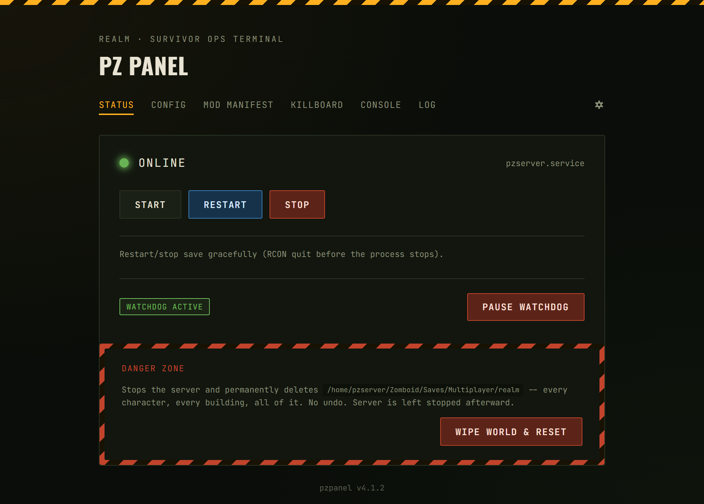
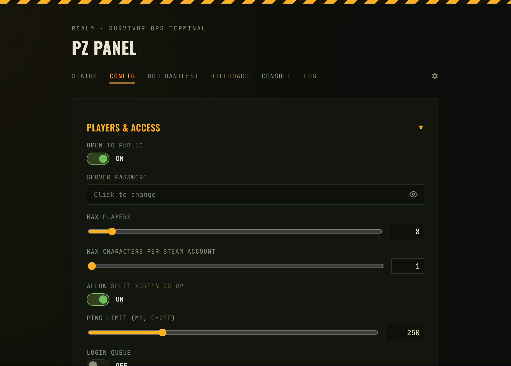
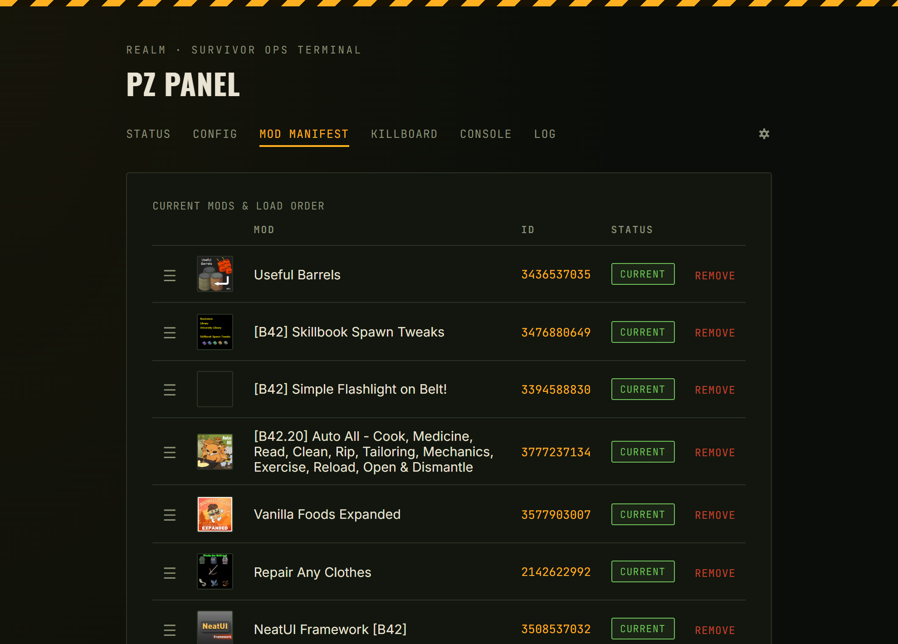
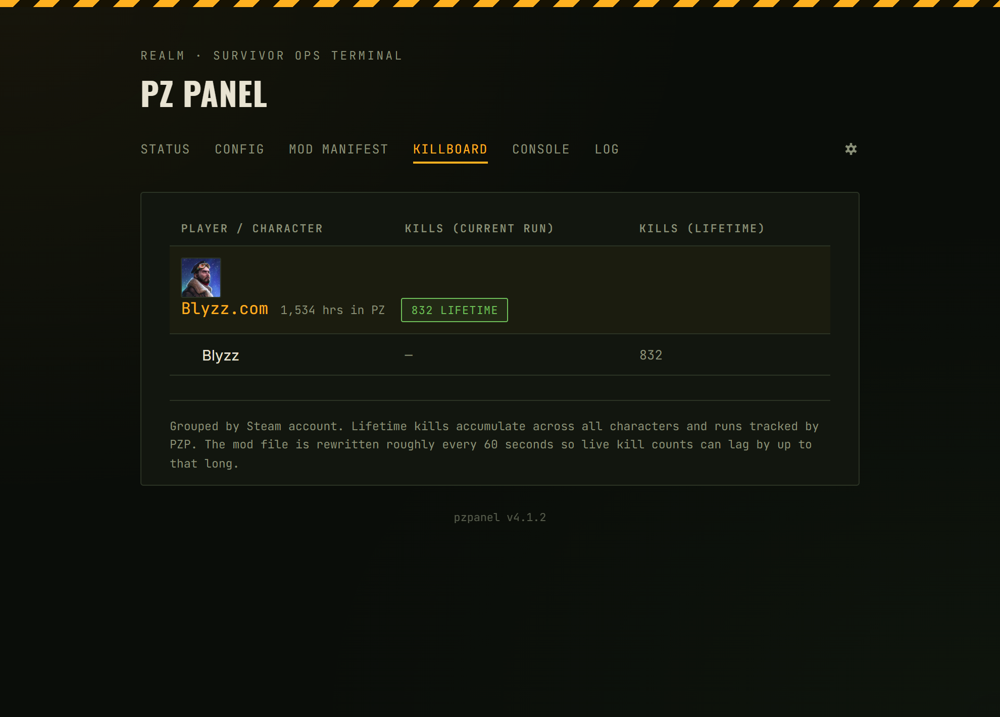
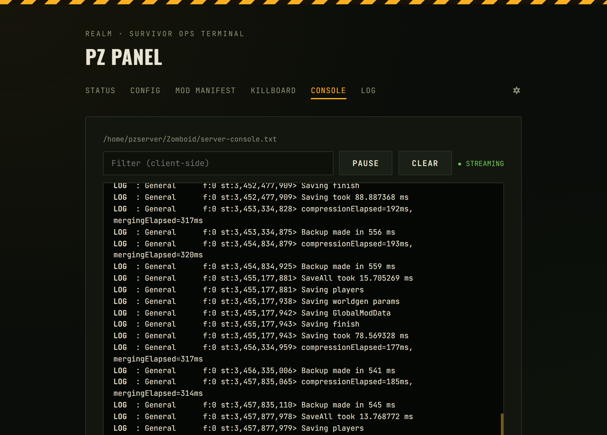
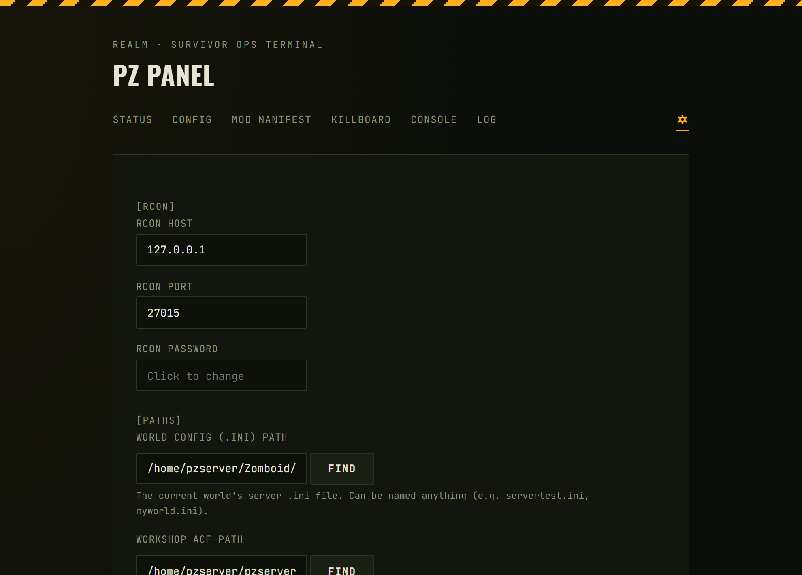

# PZ Panel &nbsp;·&nbsp; v5.8.1

A web-based control panel for a **Project Zomboid B42 dedicated server**. Manage your server, mods, and players from a browser — on Linux or Windows.

<table>
<tr>
<td></td>
<td></td>
<td></td>
</tr>
<tr>
<td></td>
<td></td>
<td></td>
</tr>
</table>

## Features

- **Status page** — start, stop, restart with live status indicator
- **Players page** — who is connected now: Steam persona, account, character, kills (run / session / lifetime), in-game survival time, time online and total time on the server; plus live status from the mod (location, health, infection, vehicle, weapon, profession, traits tinted positive/negative, every skill laid out like the game's skill screen with progress and a level-up flash, XP). Grouped player → account → character; click a player's bar to fold their whole profile (the name opens Steam), and other accounts, characters and skill groups collapse too. Updates live on join/quit
- **Config page** — edit server `.ini` settings directly from the browser (collapsible sections, cascading PVP/chat/safehouse toggles)
- **Mod Manifest** — see all Workshop mods, update status, drag-to-reorder, add/remove with optional live-server restart. Add/Enable while the server's online queues the change for the next restart instead of forcing a stop. Remove and Restart with players connected gives them the same 10-minute in-game countdown as a mod update (pause/postpone/cancel on the Status page) and removes the mod at the restart; with nobody on, it restarts straight away. Or choose Remove at Next Restart to leave the server running and drop the mod whenever it next starts or restarts. Surfaces when a mod's been downloaded (`WorkshopItems=`) but not yet loaded (`Mods=`) and offers a one-click Enable, closing the most common "I added a mod and it's not working" gap. Workshop items that bundle several mods get a checkbox picker so you choose which internal IDs go into `Mods=`
- **Killboard** — kills per Steam player, per account and per character (alive or dead), plus real time on the server, backed by a companion PZ Lua mod; updates in place when the numbers change. The Players and Killboard tabs are greyed out until the mod is in the server's mod list, and link to adding it
- **Console** — live streaming log view with filter and pause; switch between the main console log and any other log currently present in `Logs/` (connections, user, chat, cmd, PerkLog, etc.)
- **Log** — action history for everything the panel touches
- **Settings** — grouped, collapsible settings page with Linux/Windows platform toggle

---

## Requirements

- Python 3.11+
- A running Project Zomboid B42 dedicated server
- RCON enabled on the server (`RCONPort` and `RCONPassword` set in your server `.ini`)

---

## Installation (Linux)

```bash
# Clone into /opt/pzp
sudo git clone https://github.com/Blyzz616/pzp.git /opt/pzp
sudo chown -R pzserver:pzserver /opt/pzp

# Create and activate a virtualenv
sudo -u pzserver python3 -m venv /opt/pzp/venv
sudo -u pzserver /opt/pzp/venv/bin/pip install -r /opt/pzp/requirements.txt

# Copy and edit config
sudo -u pzserver cp /opt/pzp/pzpanel.ini.example /opt/pzp/pzpanel.ini
# Edit /opt/pzp/pzpanel.ini — set [rcon] and [paths] at minimum

# Install and start the systemd service
sudo cp /opt/pzp/pzpanel.service /etc/systemd/system/
sudo systemctl daemon-reload
sudo systemctl enable --now pzpanel
```

---

## Installation (Windows)

1. Clone or download the repo into a folder (e.g. `C:\pzp`)
2. Install Python 3.11+ and run:
   ```
   pip install -r requirements.txt
   ```
3. Copy `pzpanel.ini.example` → `pzpanel.ini` and fill in `[rcon]` and `[paths]`, and under `[server]` set `windows_mode` (`sc` if the server runs as a Windows service named by `unit`, `process` to launch `windows_start_script`)
4. Run `pzpanel_windows.bat` to start the panel (it creates `venv\` and installs requirements on first run)
5. Optional, for automatic mod-update restarts (Linux uses the `pzmodcheck` systemd timer): schedule `pzmodcheck_windows.bat` every 15 minutes, as the same user that runs the panel. From a Command Prompt, with your folder in place of `C:\pzp`:
   ```
   schtasks /Create /TN "PZ Panel mod check" /SC MINUTE /MO 15 /TR "\"C:\pzp\pzmodcheck_windows.bat\""
   ```
   This runs only while you're logged in. To run it logged out, open the task in Task Scheduler and choose "Run whether user is logged on or not". Leave "If the task is already running" at "Do not start a new instance": a postponed restart keeps the check running for up to ~25 hours.

Panel state (action log, kill database, queued mod changes) lives in `%LOCALAPPDATA%\pzpanel\` on Windows and `/opt/pzp/` on Linux; set `PZPANEL_DATA_DIR` to move it.

---

## Configuration

Open `pzpanel.ini` (or use the Settings page in the panel itself). Minimum required:

```ini
[rcon]
host = 127.0.0.1
port = 27015
password = your_rcon_password

[paths]
server_ini = /home/pzserver/Zomboid/Server/servertest.ini
workshop_acf = /home/pzserver/.steam/steam/steamapps/workshop/appworkshop_108600.acf
console_log = /home/pzserver/Zomboid/server-console.txt
```

On Windows the same keys take Windows paths, e.g.:

```ini
[paths]
server_ini = C:\Users\YourName\Zomboid\Server\servertest.ini
workshop_acf = C:\PZServer\steamapps\workshop\appworkshop_108600.acf
console_log = C:\Users\YourName\Zomboid\server-console.txt
```

Everything else is optional — the Settings page has descriptions for each field (except `[players] map_url`, see below).

---

## Updating

```bash
cd /opt/pzp
sudo -u pzserver git pull
sudo chown -R pzserver:pzserver /opt/pzp/*
sudo systemctl restart pzpanel
```

---

## Kill Tracking and Live Status (PZP Mod)

The Killboard and Players pages require the companion Lua mod installed on your server:

**Workshop ID:** [3793020885](https://steamcommunity.com/sharedfiles/filedetails/?id=3793020885)  
**Mod ID:** `pzp`

Add it to the server's Mods/WorkshopItems and restart the server. The mod appends each character's kill count and in-game time survived to `Zomboid/Lua/pzp_events.log` (5 seconds after a character is in the game, every 15 seconds while the count is changing, and on death). The panel reads that file into its own database (`pzp_kills.sqlite` in the panel's data directory). Both paths have defaults; override them with `event_log` / `kills_db` under `[player_events]` only if yours differ.

The mod also sends a live status (position, health, loadout, skills) every 15 seconds for the Players page. Add `map_url = https://your-map/#{x},{y}` under a `[players]` section in `pzpanel.ini` to get a "map" link per player (any http(s) URL with `{x}` and `{y}` placeholders). This one is set in the file only; it isn't on the Settings page.

Kills are tracked per character and summed per account and per Steam player. A Steam player can use several server accounts; each account has at most one living character and any number of dead ones. Tracking starts from the first report the mod sends. Nothing is imported from older versions.

---

## Discord Integration

Create a webhook in your Discord server (Server Settings → Integrations → Webhooks) and paste the URL into `pzpanel.ini`:

```ini
[discord]
webhook_url = https://discord.com/api/webhooks/...
```

Restart the panel for it to take effect. The panel posts embeds for:

- **Server up / down**
- **Join** — Steam profile link and avatar, the player's total kills, PZ hours on record, the account logging in with its kills and its living character's kills, and the two most recent other games played (needs `[steam]` with an API key for hours/games)
- **Disconnect** — real time online this session, total time on the server, the character's name with its in-game time survived and kills this run, and kills this session (from joining to leaving, across any characters that died in between). If the player's character died and they left before making a new one, it's posted as a rage-quit
- **Death** — character name (or account name), kills this run, in-game time survived
- **Kill milestones** — per character and per player, each posted once when crossed
- **Mod-update restart** — each updated mod links to its Workshop page and shows the author's change note for that update (or the first line of its description if there isn't one), when it was updated, and a link to all change notes

---

## Accessing the panel remotely

There is currently no built-in authentication - do not do this.

---

## File layout

```
/opt/pzp/
├── main.py                  # FastAPI app — all pages and routes
├── platform_compat.py       # OS abstraction (Linux/Windows)
├── discord_module.py        # Player-event watcher + Discord embeds
├── player_db.py             # SQLite store: players, accounts, characters, sessions
├── mod_restart.py           # Mod-update watchdog
├── ini_safe.py              # Backup + atomic writes for realm.ini
├── modcheck.py              # Workshop update checks (WorkshopItems=/Mods=)
├── steam_workshop.py        # Steam API lookups
├── rcon.py                  # RCON client
├── actionlog.py             # Panel action log
├── countdown_control.py     # Restart countdown state
├── automation.py            # Watchdog pause flag
├── removed_mods.py          # Previously-removed mod list
├── pending_mods.py          # Mod changes queued for the next restart
├── graceful_stop.py         # Graceful server stop helper
├── acf.py                   # Steam ACF parser
├── server_config.py         # Config loading, server control, INI helpers
├── ui_helpers.py            # HTML rendering helpers
├── discord_webhook.py       # Shared Discord webhook client
├── kill_tracker.py          # Reads the mod's event log into player_db, milestones
├── requirements.txt         # Python dependencies
├── pzpanel.ini.example      # Config template
├── pzpanel.service          # systemd unit for the panel
├── pzmodcheck.service       # systemd unit: one mod-update check
├── pzmodcheck.timer         # systemd timer: runs pzmodcheck every 15 min
├── pzserver.service         # example systemd unit for the PZ server itself
├── pzpanel_windows.bat      # Windows launcher
├── pzmodcheck_windows.bat   # Windows mod-update check (schedule with Task Scheduler)
├── favicon/                 # Panel icons
├── mod images/              # Workshop artwork for the pzp mod
└── pzp/
    ├── 42/                  # Workshop mod (mod.info, media/lua/{client,server,shared})
    └── screens/             # UI screenshots
```

---

## Version

**v5.8.1** — remove dialog: the long online note is gone, the confirm button is now "Remove and Restart", and both remove buttons sit right-aligned. v5.8.0: Mod Manifest: "Remove at Next Restart" option when removing a mod while the server is online; cancelling a queued change refreshes the page so the mod's status updates. v5.7.1: Players page: clicking the player bar folds the whole profile (it did nothing for players with one account); other accounts moved to their own row. v5.7.0: Remove & Restart runs the 10-minute in-game countdown when players are connected (removal applied at the restart); the online status light pulses smoothly (bright, dim, repeat) instead of flickering. v5.6.3: Steam profile link moved from the "On Steam" hours to the player name; v5.6.2: loading animation fills squares one at a time, holds all gold for 0.4 s, then empties; v5.6.1: Players page: skill groups and whole characters collapse (click the group icon or the character name); the loading animation empties fully before refilling; v5.6.0: Players page shows every skill like the game's skill screen (squares, progress, level-up flash), traits tinted green/red, a loading animation instead of the "no live status" text, help text moved into a tooltip; Players and Killboard tabs grey out and offer to add the PZP mod when it is not in the manifest; Status/Killboard text cleanup (needs a Workshop update of the `pzp` mod for skill progress); v5.5.2: mod: no more error spam in the game log every 15 s (needs a Workshop update); v5.5.1: Players page redesigned: stats tiles, labelled live panel with a health bar and trait/skill chips, fixed-width counters so the page no longer jumps when times grow; v5.5.0: Players page grouped by Steam player → account → character with collapsible sections (other accounts behind the player bar, other characters behind each account); v5.4.1: Players page status row wraps instead of stretching the table; v5.4.0: new Players page (who is online, with persona, account, character, kills, time stats and live mod status such as location, health and loadout, updating live; needs the updated mod); v5.3.0: disconnect posts show the character's name, in-game time survived and kills this run; in-game time is written like the game does ("1 month, 19 days, 15 hours"). v5.2.1: mod-update restart posts show the mod's change note (or description) and update time instead of the Workshop ID; session kills stay correct when the game rolls a character's kill count back. v5.2.0: Windows fixes: the Mods page and the action log no longer use hardcoded Linux paths; new `pzmodcheck_windows.bat` for scheduled mod-update restarts; batch files always get Windows line endings; mod event log read correctly if Java writes it in the Windows codepage. v5.1.0: the Killboard page updates itself when kills or players change (polls every 5 seconds, no full reload). v5.0.1: the mod's first report for a character is sent once it's in the game (it was being lost at load, so the first kill of a session wasn't counted; needs a Workshop update); less empty space in the join embed. v5.0.0: major rewrite of kill tracking: the Workshop mod now reports deaths and character names and appends to an event log the panel actually reads; kills are stored per character in a new database and summed per account and player; session kills and time on server survive panel restarts; join/disconnect/rage-quit/death embeds reworked; milestones post once. **Needs a Workshop update of the `pzp` mod.** v4.6.4: `requests` added to `requirements.txt` (the panel imports it at startup) and install steps now use `pip install -r requirements.txt` (adds the missing `python-multipart`); v4.6.3: description BBCode repairs truncated/odd markup (`[hr][/hr]`, cut-off `[b]`), adds `[quote]`/`[code]`/`[spoiler]`/`[img]`, and only allows http(s) links; v4.6.2: scrollbars match the dark theme and truncated descriptions no longer show raw `[list]`/`[*]` tags; v4.6.1: every panel edit of the server `.ini` is now backed up (`backups/`, newest 20) and written atomically; the Enable modal shows a checkbox picker (with each mod's `mod.info` name) when a Workshop item bundles more than one internal mod ID, so you pick which go into `Mods=`; "Needs Enable" now triggers only when none of a mod's IDs are enabled, so deliberately skipped placeholder IDs stop nagging.

See `CHANGELOG.md` for full history.
